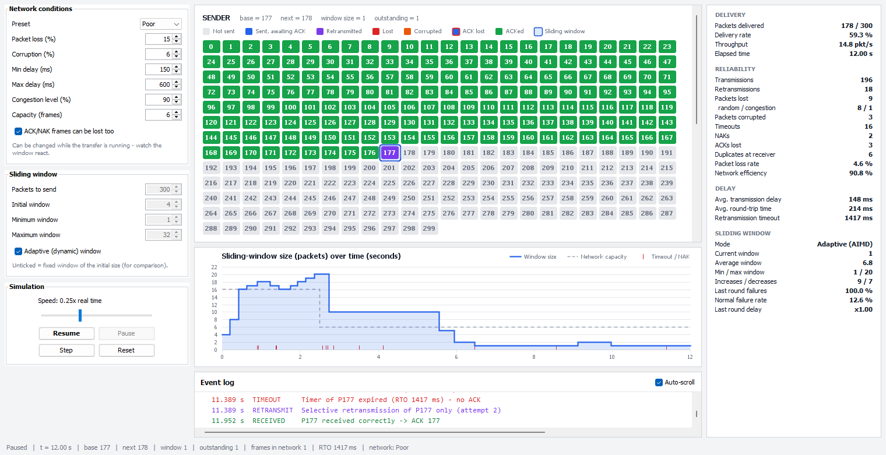
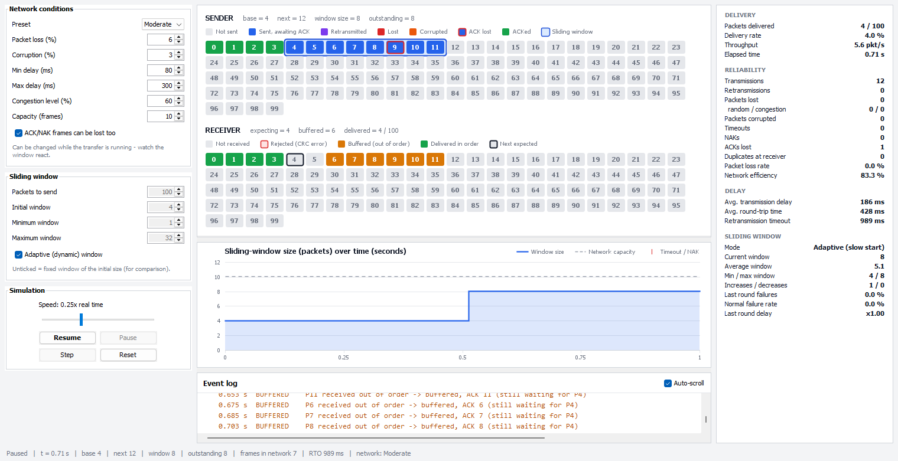

# Adaptive Selective Repeat ARQ Protocol using Dynamic Sliding Window and Network Condition Simulation

A Java / Swing simulator that delivers packets reliably over an unreliable virtual network using
**Selective Repeat ARQ**, and **changes the sliding-window size while the transfer runs**
according to the observed loss, retransmissions, delay and congestion.

**Tools:** Java · Java Swing · IntelliJ IDEA / VS Code · Git/GitHub
(pure Java, no external libraries, runs on Java 8 or newer)



---

## 1. How it works

1. **Packets.** The Packet Generator creates N packets. Each one carries a sequence number, a 64-byte payload and a **CRC-32 checksum**.
2. **Sliding window.** The sender may have up to `W` packets outstanding: `[base, base + W - 1]`. When the packet at `base` is acknowledged, the window slides forward.
3. **Unreliable network.** Every frame (data, ACK or NAK) may be:
   - **lost** (random drop),
   - **dropped by congestion** (more frames in the network than its capacity),
   - **corrupted** (one bit flipped),
   - **delayed** (random propagation delay, plus queueing delay when congested).

   Because each frame gets its own delay, frames can also arrive **out of order**.
4. **Selective Repeat receiver.** The receiver checks the CRC of every packet:
   - Correct packets are **ACKed individually** and **buffered** if they arrive out of order. They're delivered to the application **in order** once the gap is filled.
   - Corrupted packets are discarded, and a **NAK** asks for that packet again immediately.
5. **Selective retransmission.** Every outstanding packet has its **own timer**. On a timeout (packet or ACK lost) or a NAK, **only that packet** is resent, not the whole window as in Go-Back-N. The timeout follows the measured RTT (RFC 6298: `RTO = SRTT + 4·RTTVAR`).
6. **Adaptive window (main feature).** After each round of feedback (one window's worth of ACKs and failures, about one RTT), the controller decides:
   - no rise in loss or delay → **window + 1** (doubles during the initial slow start)
   - loss or delay rising → **window − 1**
   - loss or delay jumped well above normal → **window ÷ 2**

   This is the AIMD (additive increase, multiplicative decrease) idea used by TCP congestion control.

Example from the proposal: packets 1–5 are sent and 2 and 5 fail. Packets 1, 3 and 4 are buffered and ACKed, and **only 2 and 5 are retransmitted**.

## 2. Architecture

```
 PacketGenerator ──► Sender ──► SlidingWindowController ──► UnreliableNetworkSimulator ──► Receiver
                       ▲                                       (loss · corruption · delay      │
                       │                                        · congestion · reordering)     │
                       │                                                                       │
 AdaptiveWindowController ◄── AckManager ◄────────────────── ACK / NAK ◄───────────────────────┘
   (changes window size)          │
                                  ▼
                       RetransmissionController (one timer per packet, resends only failed packets)

 PerformanceAnalyzer collects all metrics  ·  Java Swing GUI visualises everything
```

| Component (from the proposal) | Class | File |
|---|---|---|
| Packet Generator | `PacketGenerator`, `Packet` | `src/arq/core/` |
| Sender | `Sender` | `src/arq/core/Sender.java` |
| Sliding Window Controller | `SlidingWindowController` | `src/arq/core/SlidingWindowController.java` |
| Unreliable Network Simulator | `UnreliableNetworkSimulator`, `NetworkConfig` | `src/arq/core/` |
| Receiver | `Receiver` | `src/arq/core/Receiver.java` |
| ACK Manager | `AckManager`, `AckPacket` | `src/arq/core/` |
| Retransmission Controller | `RetransmissionController` | `src/arq/core/RetransmissionController.java` |
| Adaptive Window Controller | `AdaptiveWindowController` | `src/arq/core/AdaptiveWindowController.java` |
| Performance Analyzer | `PerformanceAnalyzer` | `src/arq/core/PerformanceAnalyzer.java` |
| Java Swing GUI | `MainFrame`, `PacketPanel`, `WindowGraphPanel`, `MetricsPanel`, `EventLogPanel`, `ControlPanel` | `src/arq/gui/` |

Supporting classes:

- `Simulation` wires the components together.
- `EventScheduler` is a discrete-event clock. Every arrival and timer is an event executed in time order, so the GUI can pause, step and change speed.
- `ExperimentRunner` runs the headless comparison.

## 3. How to run

You need a **JDK 8 or newer** (`javac -version` must work in a terminal).

| Way | What to do |
|---|---|
| **Double-click** | `run.bat` compiles and opens the simulator. `run-experiment.bat` runs the comparison table. |
| **Ready-made jar** | `java -jar AdaptiveSRARQ.jar` (GUI) or `java -jar AdaptiveSRARQ.jar --experiment` |
| **IntelliJ IDEA** | *File → Open* the project folder, right-click `src` → *Mark Directory as → Sources Root*, then run `arq.Main`. |
| **VS Code** | Install the *Extension Pack for Java*, open the folder, open `src/arq/Main.java` and click **Run**. |
| **Terminal** | `javac -d out -sourcepath src src/arq/Main.java` then `java -cp out arq.Main` |

Experiment options: `java -cp out arq.Main --experiment [packets] [runs]`, for example `--experiment 500 30`. Results are printed and also saved to `experiment_results.csv`.

## 4. Using the simulator



| Area | Shows |
|---|---|
| **Left – Network conditions** | Preset **Good / Moderate / Poor** or custom values for loss %, corruption %, min/max delay, congestion level and capacity. These can be changed **while the transfer is running**. |
| **Left – Sliding window** | Number of packets, initial/min/max window, and an *Adaptive* checkbox (untick for a fixed window to compare). |
| **Left – Simulation** | Speed (0.05× – 5× real time), **Start / Pause / Step / Reset**. *Step* executes one event at a time. |
| **Sender grid** | grey = not sent, blue = awaiting ACK, purple = retransmitted, red = lost, orange = corrupted, red border = its ACK was lost, green = ACKed. The **blue band is the sliding window**. |
| **Receiver grid** | amber = received out of order and buffered, green = delivered in order, red border = rejected by the CRC check, black outline = next expected packet. |
| **Window graph** | Window size over time, the network capacity (dashed) and every timeout/NAK (red ticks). |
| **Event log** | Every send, loss, corruption, ACK, NAK, timeout, selective retransmission and window change, colour-coded and time-stamped. |
| **Metrics** | Delivery rate, throughput, retransmissions, loss rate, average delay, RTT, RTO, efficiency, window statistics. |

When the transfer finishes, a summary appears with a **data-integrity check**. It confirms that every packet reached the application in order and byte-for-byte identical to what was sent.

### Suggested demonstration (≈ 5 minutes)

1. **Selective Repeat.** Choose *Moderate*, set speed to about 0.1×, press **Step** a few times and then **Start**. Point out a red (lost) packet, the amber buffered packets after it at the receiver, the timeout, and that **only that packet** is retransmitted (purple). Then "Gap filled → delivered in order".
2. **Adaptive window.** *Reset*, choose *Good*, 300 packets, **Start**. The window doubles (slow start) and then settles around the capacity line.
3. **Changing conditions.** While it runs, switch the preset to **Poor**. The window is halved repeatedly and the log explains why (`failures 60% (normal 5%) … halve window`). Switch back to **Good** and the window grows again.
4. **Comparison.** Untick *Adaptive* to run with a fixed window, or run `run-experiment.bat` for the full table below.

## 5. Adaptive window algorithm

At the end of each round:

- **failure rate** `f = (timeouts + NAKs) / feedback`
- **normal failure rate** `p`, a moving average that learns improvements quickly and a worse network only slowly
- **random variation** `σ = √(p(1−p)/n)`
- **delay ratio** `d = round's average RTT / long-term average RTT`

| Condition | Action | Meaning |
|---|---|---|
| `f − p > max(3σ, 20%)` or `d ≥ 2.0` | window ÷ 2 | severe loss or congestion: back off fast |
| `f − p > 2σ` or `d ≥ 1.4` | window − 1 | conditions getting worse |
| `f − p ≤ σ` and `d ≤ 1.2` | window + 1 (×2 in slow start) | no rise in loss or delay: probe for more bandwidth |
| otherwise | unchanged | |

Slow start ends at half the maximum window or at the first problem. Comparing against the network's *normal* failure rate means the background loss of a noisy link does not keep the window small for no reason. A *rise* in loss, which is what pushing too many packets into a congested network causes, does shrink it.

## 6. Network simulation model

| Preset | Loss | Corruption | Delay (one way) | Congestion level | Capacity |
|---|---|---|---|---|---|
| Good | 2 % | 1 % | 40–120 ms | 30 % | 16 frames |
| Moderate | 6 % | 3 % | 80–300 ms | 60 % | 10 frames |
| Poor | 15 % | 6 % | 150–600 ms | 90 % | 6 frames |

**Congestion.** When `n` frames are in the network and `b = n − capacity > 0` of them are over capacity:

- each new frame is dropped with probability `congestionLevel · b / n`;
- each new frame waits an extra `congestionLevel · b · 15 ms` of queueing delay.

So the more the sender pushes into an overloaded network, the more loss and delay it gets back.

## 7. Performance metrics

| Metric | Definition |
|---|---|
| Packet delivery rate | packets delivered to the application / packets generated |
| Packet loss rate | data transmissions dropped by the network / all data transmissions |
| Retransmissions | transmissions beyond the first one of each packet |
| Average transmission delay | first transmission of a packet → first correct copy received |
| Throughput | packets delivered per second (simulated time) |
| Network efficiency | unique packets received correctly / all data transmissions |
| Window size changes | min / max / time-weighted average window, number of increases and decreases |

## 8. Results

`run-experiment.bat`: 200 packets per run, average of 20 runs with the same random seeds for every mode.

| Network | Mode | Delivered | Loss % | Retransmissions | Avg delay (ms) | Throughput (pkt/s) | Efficiency | Avg window |
|---|---|---|---|---|---|---|---|---|
| Good | Fixed window = 4 | 100 % | 2.1 | 11.5 | 87 | 19.0 | 94.6 % | 4.0 |
| Good | Fixed window = 16 | 100 % | 2.0 | 11.0 | 89 | 47.6 | 94.8 % | 16.0 |
| Good | **Adaptive** | 100 % | 2.0 | **10.9** | 88 | **49.4** | **94.9 %** | 14.1 |
| Moderate | Fixed window = 4 | 100 % | 6.0 | 34.4 | 248 | 5.8 | 85.4 % | 4.0 |
| Moderate | Fixed window = 16 | 100 % | 8.3 | 58.2 | 284 | 11.9 | 77.5 % | 16.0 |
| Moderate | **Adaptive** | 100 % | 6.4 | **34.5** | 254 | 7.0 | **85.4 %** | 5.2 |
| Poor | Fixed window = 4 | 100 % | 16.1 | 96.7 | 714 | 1.9 | 67.6 % | 4.0 |
| Poor | Fixed window = 16 | 100 % | 22.3 | 169.5 | 924 | 3.8 | 54.2 % | 16.0 |
| Poor | **Adaptive** | 100 % | 17.3 | **112.4** | 739 | 2.3 | **64.3 %** | 6.3 |

Observations:

- **Reliable delivery.** 100 % of packets are delivered in order, and the integrity check passes in every run, despite loss, corruption, reordering and congestion.
- **Good network.** The adaptive window grows on its own, so it gets **2.6× the throughput of a small fixed window** and slightly more than a large one.
- **Moderate / poor network.** It shrinks the window to control traffic. That gives **34–41 % fewer retransmissions** and a lower loss rate than the large fixed window, while still delivering about **20 % more throughput** than the small fixed window.
- **No single fixed window is best for every network.** The adaptive window gets close to the best of both automatically, and it re-adjusts when conditions change mid-transfer (Good → Poor: average window 13.6 → 6.2; Poor → Good: 8.1 → 17.4).

## 9. Future scope

- Advanced adaptive algorithms (e.g. TCP CUBIC/BBR-style rate estimation)
- More realistic congestion control (router queues, bandwidth limits)
- Real-time packet animation between sender and receiver
- Detailed graphs (throughput, RTT, loss over time) and export
- Larger simulations with several competing senders
- Side-by-side comparison with Go-Back-N and Stop-and-Wait ARQ

## Project structure

```
Adaptive-SR-ARQ/
├── src/arq/
│   ├── Main.java                 entry point (GUI or --experiment)
│   ├── ExperimentRunner.java     headless comparison of fixed vs adaptive window
│   ├── core/                     protocol, network simulator, adaptive controller, metrics
│   └── gui/                      Swing user interface
├── docs/screenshots/             screenshots of the simulator
├── AdaptiveSRARQ.jar             ready-to-run build
├── experiment_results.csv        results of the experiment above
├── run.bat / run-experiment.bat  Windows launchers
└── run.sh                        Linux / macOS launcher
```
